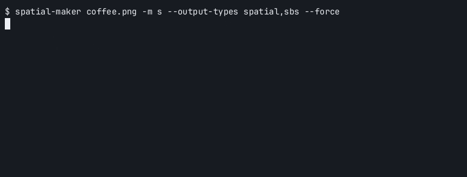
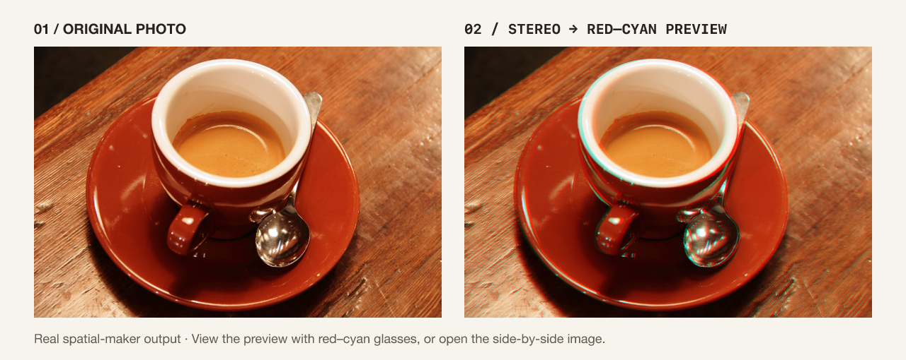

# spatial-maker

Convert ordinary photos and videos into spatial HEIC photos and MV-HEVC video for Apple Vision Pro, locally on your Mac.

[](https://github.com/mrgnw/spatial-maker/actions/workflows/ci.yml)
[](LICENSE)
[](https://github.com/mrgnw/spatial-maker/releases/latest)
[](https://github.com/mrgnw/spatial-maker/commits/main)
[](https://github.com/mrgnw/spatial-maker/issues)
[](Cargo.toml)
[](#requirements)
[](https://crates.io/crates/spatial-maker)


A photo in a box, seen from a moving viewpoint. The depth map comes from spatial-maker; the box effect is a web demo, not the Vision Pro rendering. [MP4](docs/media/hero-3d.mp4) · [depth map](docs/media/coffee-depth.png) · [how it was made](docs/media/README.md#3d-box-hero).

> [!NOTE]
> This project was built with heavy LLM assistance and should be considered proof-of-concept. Contributions are welcome, but I can't guarantee the accuracy of the code or that I will continue to maintain it. If there are any mistakes in attribution or anything else, please let me know.



Real v0.8.0 conversion on Apple Silicon, with the model already downloaded and depth regenerated. Idle gaps are shortened in the GIF. [Original asciinema recording](docs/media/conversion.cast).

## What it does

spatial-maker estimates a depth map, renders a second eye with depth-image-based rendering (DIBR), and writes stereo media. Pretrained depth estimation is one step in the local conversion pipeline. Your photos and videos stay on your machine; the first run downloads model weights.

| Input | Output |
|-|-|
| A 2D photo | Spatial HEIC, side-by-side, top-and-bottom, separate eyes, or a depth map |
| A 2D video | Spatial MV-HEVC in a `.mov` container, with audio when present |

Stereo is inferred from a single view. Hidden surfaces must be filled, so edges and occluded areas can show artifacts. Vision Pro playback has not yet been checked on a device; see [#2](https://github.com/mrgnw/spatial-maker/issues/2).

The work in this repository is the media pipeline: stereo rendering and hole filling, edge refinement, temporal smoothing of video depth, and native HEIC and MV-HEVC writers in Swift. Depth comes from pretrained, off-the-shelf models that run locally through Apple's CoreML. This project uses those models; it does not train, tune or serve them.

## Who it is for

People with a Vision Pro (or any spatial-photo viewer) who want their existing photos and clips in 3D without a cloud service, and Rust developers who want a library for 2D-to-stereo conversion.

## Check it in your headset

The hero above only simulates depth on a flat screen. The real output is a stereo pair: download the [spatial HEIC](docs/media/coffee-spatial.heic) and open it on a spatial-photo viewer.



No headset needed to inspect the [side-by-side image](docs/media/coffee-sbs.png). For the anaglyph above, use red–cyan glasses (red on the left). Photo: Rachel Michetti, CC0, courtesy of Pikolo Espresso Bar via scikit-image. [Source, exact commands, and preview details](docs/media/README.md).

## Built with

- Rust: CLI, library, photo and video pipeline
- Swift bridge: CoreML, ImageIO (stereo HEIC), AVFoundation and VideoToolbox (MV-HEVC)
- Pretrained depth models: [Depth Anything V2](https://github.com/DepthAnything/Depth-Anything-V2), Depth Anything 3, Video Depth Anything
- ffmpeg for frame extraction and audio

## Requirements

- macOS 14+ on Apple Silicon
- Xcode Command Line Tools (the build compiles the Swift bridge)
- Rust 1.88+ (the highest minimum among locked dependencies; not tested on older toolchains)
- ffmpeg, for video

```sh
xcode-select --install
brew install ffmpeg rust
```

## Install

| Method | What you need | Download or instructions |
|-|-|-|
| macOS release binary | macOS 14+, Apple Silicon; ffmpeg for video | [v0.8.0 tarball](https://github.com/mrgnw/spatial-maker/releases/download/v0.8.0/spatial-maker-v0.8.0-aarch64-apple-darwin.tar.gz) · [All releases](https://github.com/mrgnw/spatial-maker/releases) |
| Build from Git | The above, Rust 1.88+, Xcode Command Line Tools | Use the source install below |

The release archive contains the binary only. Extract it into a directory on your PATH, or run it directly from the extracted folder. Rust and Xcode Command Line Tools are needed only when building from source.

### From source

```sh
cargo install --git https://github.com/mrgnw/spatial-maker --locked
```

The crates.io badge points to this owner's published package, but that package is still v0.3.2. Prefer a release binary or the Git install for the current converter.

## Usage

Models download on first use (about 48 MB for the default video model, 638 MB for the default photo model). Weights are cached in `$HOME/.spatial-maker/checkpoints`; `SPATIAL_MAKER_CHECKPOINTS` selects a different directory. After the weights are available, conversion runs locally without a cloud service.

### Photo to spatial HEIC

Set the input to your photo, then run the conversion unchanged:

```sh
INPUT="$HOME/Pictures/photo.jpg"
```

```sh
spatial-maker "$INPUT"
```

For `photo.jpg`, the default output is `photo-da3-spatial.heic` beside the input. Choose `-m s` for the smaller 48 MB model.

### Try the included photo without a headset

From a source checkout, use the CC0 sample to write a spatial HEIC and a side-by-side preview:

```sh
INPUT="$PWD/docs/media/coffee.png"
OUTPUT=/tmp/spatial-demo/coffee
```

```sh
mkdir -p /tmp/spatial-demo
spatial-maker "$INPUT" -o "$OUTPUT" -m s --output-types spatial,sbs
```

Open `coffee-spatial.png` in `/tmp/spatial-demo` to inspect the two eye views in an ordinary image viewer. The companion `coffee-spatial.heic` is the spatial photo. The [demo media notes](docs/media/README.md) explain the anaglyph preview.

### Video to spatial MV-HEVC

```sh
INPUT="$HOME/Movies/clip.mp4"
OUTPUT="$HOME/Movies/clip_spatial.mov"
```

```sh
spatial-maker "$INPUT" -o "$OUTPUT"
```

Videos use `-m s` by default. `-m vda` (steadier video depth) needs a model that is not publicly downloadable yet; see [Models and licenses](#models-and-licenses).

## Options

| Flag | Meaning |
|-|-|
| `-m s`, `b`, `l`, `da3`, `vda` | Depth model. Photos default to `da3`, videos to `s` |
| `--max-disparity` | 3D strength in pixels. Default is 1.2% of image width |
| `--output-types` | `spatial` (default), `sbs`, `tab`, `sep`, `depth` |
| `--heic-quality` | Spatial photo quality, default 80 |
| `--temporal-alpha` | Video depth smoothing, default 0.7 |

Full list:

```sh
spatial-maker --help
```

## Library

```toml
[dependencies]
spatial-maker = { git = "https://github.com/mrgnw/spatial-maker" }
```

See `examples/` for runnable photo and stereo-from-depth programs.

## Models and licenses

spatial-maker is MIT. The depth models have their own terms, taken from the upstream model cards and repositories ([Depth Anything V2](https://github.com/DepthAnything/Depth-Anything-V2#license), [Video Depth Anything](https://github.com/DepthAnything/Video-Depth-Anything#license), [DA3MONO-LARGE](https://huggingface.co/depth-anything/DA3MONO-LARGE)):

| Model | License |
|-|-|
| Depth Anything V2 Small (`s`) | Apache-2.0 |
| Depth Anything V2 Base and Large (`b`, `l`) | CC BY-NC 4.0, non-commercial |
| Depth Anything 3 Mono Large (`da3`) | Apache-2.0 |
| Video Depth Anything Small (`vda`) | Apache-2.0 |

The MIT license covers this repository's code only. It does not relicense any model weights.

Where the weights come from:

- This repository contains no model weights, and the release tarballs contain only the `spatial-maker` binary.
- Weights are downloaded at runtime, on first use, by the tool running on your machine.
- The downloaded files are CoreML conversions that the author hosts on Hugging Face: [mrgnw/depth-anything-v2-coreml](https://huggingface.co/mrgnw/depth-anything-v2-coreml) (V2 Small, Base, Large) and [mrgnw/depth-anything-v3-coreml](https://huggingface.co/mrgnw/depth-anything-v3-coreml) (DA3 Mono Large). They are redistributed there, outside this repository. The conversion scripts are in `scripts/coreml_conversion/`.
- The `vda` download points at `mrgnw/video-depth-anything-coreml`, which is not publicly available yet, so `-m vda` only works if you already have that model locally.
- Base and Large are non-commercial: check that your use fits CC BY-NC 4.0 before choosing `-m b` or `-m l`.

## Roadmap

See [ROADMAP.md](ROADMAP.md) and the [open issues](https://github.com/mrgnw/spatial-maker/issues).

## Contributing

See [CONTRIBUTING.md](CONTRIBUTING.md) for the macOS build, tests, and pull request guidance. Start with a [good first issue](https://github.com/mrgnw/spatial-maker/issues?q=is%3Aissue%20state%3Aopen%20label%3A%22good%20first%20issue%22), or share a reproducible conversion problem using the issue templates.

## Acknowledgments

- [Depth Anything V2](https://github.com/DepthAnything/Depth-Anything-V2)
- [Mike Swanson's spatial](https://blog.mikeswanson.com/spatial_docs/) for MV-HEVC groundwork

## License

[MIT](LICENSE)
